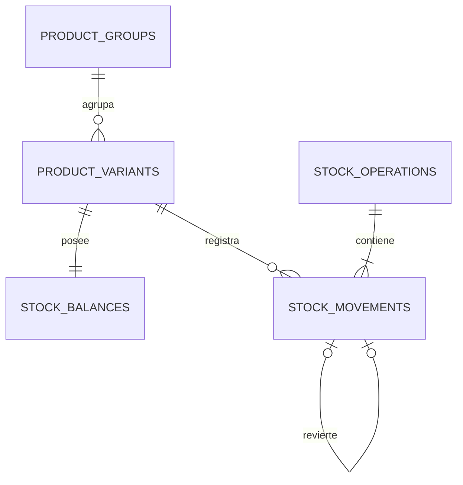

# T02 — Plan técnico incremental para R01–R63

Fecha: 21/10/2026. Fuente vinculante: [REGLAS_ECONOMICAS_ADARA.md](REGLAS_ECONOMICAS_ADARA.md); diferencias y preguntas: [CONFLICTOS_Y_PENDIENTES.md](CONFLICTOS_Y_PENDIENTES.md). Este plan es una **propuesta de implementación**, no una migración aprobada ni una ampliación de las 63 reglas. Complementa `03_PLAN_DE_ENTREGAS.md`; antes de cambiar el orden de los tickets existentes hay que actualizar ese plan con aprobación explícita. T00/T01 son auditorías históricas, y T02 sigue abierto hasta aceptar el esquema y las decisiones que afecten el primer módulo.

## Punto de partida comprobado

- Starter Laravel 13.38.0 / PHP 8.4.13 / Livewire 4.4.7 / Tailwind 4.3.3 / Vite 8.3.4 / PHPUnit 12.5.40; SQLite predeterminada. Laravel Boost MCP responde a información de aplicación, conexiones, esquema, consulta de solo lectura y búsqueda de documentación; no expone `list_routes`.
- Ruta propia actual: solo `/` con vista `welcome`. Modelo: solo `User`. Tres migraciones iniciales registradas, nueve tablas de infraestructura; ningún dato comercial o componente Livewire de Adara observado.
- El diseño original tiene 17 pantallas y 20 modales, pero no cubre todas las operaciones ahora aprobadas. Las nuevas vistas deberán conservar sus tokens y lenguaje visual, con flujos adicionales diseñados antes de implementarse.
- `vite.config.js` configura Bunny Instrument Sans; resolver fuentes locales/fallback antes de declarar funcionamiento offline. No depender de `public/hot` en la Mac.

## Secuencia propuesta de incrementos revisables

| Orden | Entrega y reglas | Esquema candidato (solo propuesta) | Prueba de aceptación mínima y dependencia |
| --- | --- | --- | --- |
| I00 | Cerrar T02: aprobar ERD y términos de eventos; resolver solo pendientes que afecten el primer incremento. | Diagrama/contrato de grupos, SKU, movimientos y referencias; sin migración. | Revisión de reglas R01–R63 frente a la propuesta y ausencia de módulos descartados. |
| I01a | Fundamento monetario puro: importar cadenas ARS, centavos, costo unitario a 4 decimales, porcentajes decimales, techo comercial y asignación determinista R31. | Ninguna. Clases pequeñas bajo `app/` según convención elegida al comenzar. | PHPUnit: `14.250→14.300`, `15.000→15.000`, `1.000/3→333,33+333,33+333,34`, límites de rango, entrada inválida, suma exacta y sin `float`. No requiere SQLite real. |
| I01b | Registro transaccional de stock, saldo no negativo e idempotencia de ajustes R11/R14–R15/R42/R43/R48/R50. | `product_groups`, `product_variants`, `stock_movements` y saldo por SKU o cálculo con restricción transaccional; evaluar `operation_keys`/índice único. | SQLite de prueba: entrada/salida, intento de negativo, motivo obligatorio, repetición de clave, rollback y dos intentos sobre última unidad. Depende de ERD I00 e I01a. |
| I02 | Catálogo: agrupadores/presentaciones, código único, costo de reposición, recargos, precio calculado, historial, mínimo, activar/desactivar y borrar solo no usado R01/R03–R05/R32–R37/R42. | Variantes, categorías/proveedores si hacen falta para el flujo, `price_history`, configuración de recargo. | UI→validación→DB: SKU único, override, vista previa y confirmación masiva, precio no editable, inactivación solo stock 0, borrado solo sin referencias. Depende de I01a/I01b. |
| I03 | Compras y recepciones: pedido, entrega parcial, costo real, flete general/adicional, advertencias, cancelación de pendiente y corrección R02/R27–R30/R45–R47. | `purchase_orders`, líneas, recepciones, líneas recibidas, asignaciones de flete, cancelaciones y correcciones vinculadas. | Suma de flete exacta, recepciones 8+4 de 12, sobreentrega confirmada sin pendiente negativo, costo/precio solo al recibir, corrección segura. Resolver pendientes R30/R45 antes de esta migración. |
| I04 | Ventas, promoción/descuento global, pagos mixtos, fiados, comisiones, crédito opcional y vuelto R06–R08/R11–R13/R23–R25/R38–R41/R58–R61. | `sales`, líneas snapshot, promociones, cobros, asignaciones a ventas, cuentas por cobrar o saldos derivados y confirmaciones auditadas. | Venta atómica con stock y snapshots; una sola modalidad de descuento; fiado con clienta; cobro desde venta aplicado solo a esa venta; límites y avisos; ninguna doble confirmación. Cobranza conjunta en flujo posterior por definir. Resolver recargos R08 y vigencia R40 antes de activarlos. |
| I05 | Anulación, devoluciones, reintegros, cambios y contracargos R09–R10/R21–R22/R26/R51–R55. | Eventos reversores, devoluciones/líneas, obligaciones y pagos de reintegro, vínculos de cambio, anulaciones de cobros y contracargos. | Devolución no excede unidades; deuda baja antes de reintegro; fechas reales; cambio 18k→23k cobra 5k; sin doble stock ni dinero. Resolver imputaciones R22/R26/R55 primero. |
| I06 | Gastos, reintegros de proveedor, bajas y recuperaciones de deuda R18/R44/R56–R57. | Gastos, reintegros proveedor, bajas y recuperaciones vinculadas. | Ningún ingreso se disfraza de venta; baja 20k/recuperación 8k deja 12k no recuperados; no duplica gastos ni costo de envío. |
| I07 | Dashboard y reportes trazables R19–R21/R63, exportación y respaldos. La carga inicial no requiere importación Excel; reabrirla solo si se solicita en el futuro. | Consultas agregadas e índices de fechas/referencias; tablas auxiliares solo si la medición demuestra necesidad. | Conciliar cada KPI con eventos base, períodos y reversos fechados; sin saldo bancario ficticio. Respaldar y restaurar copia aislada antes de entrega Mac. |
| I08 | Verificación offline y lanzamiento local macOS. | Sin nuevo dato comercial por defecto. | Build empaquetado, sin requests externos, teclado y responsive, apertura por acceso directo, respaldo/recuperación en Mac real. |

La numeración I00–I08 evita confundir este plan con los tickets T00–T29 existentes. I01a se implementó como biblioteca pura. El usuario aceptó continuar con el ERD propuesto el 21/10/2026; I01b inició su implementación de persistencia y ajustes. Cada incremento exige revisión de código existente, tests aislados, validación en servidor cuando haya UI, documentación y verificación manual. Nunca usar `migrate:fresh` sobre la base local de la usuaria.

## Modelo de eventos y límites de responsabilidad

- `product_groups` agrupa; `product_variants`/SKU posee stock, costo de reposición con cuatro decimales, recargo y precio. El costo vigente cambia con recepción válida, no con ajuste gratuito. Las ventas guardan costo y precio de su fecha.
- `stock_movements` guarda delta, SKU, fecha efectiva, tipo, motivo, operación origen y referencia al reversor. Saldo no negativo se protege dentro de transacciones; índice/clave de operación evita repetir entradas o salidas. Una vista nunca decide el saldo final.
- Pedido y recepción son hechos distintos. El pedido no cambia stock/costo/precio. Cada recepción conserva cantidad y costo reales, distribución de flete y confirmación de diferencias; eventos posteriores corrigen sin sobrescribir snapshots históricos.
- Venta, cobro, asignación de cobro, devolución, obligación de reintegro, pago de reintegro, contracargo y baja incobrable son hechos distintos. No guardar «pagado» como sustituto del historial de cobros ni calcular recaudación sumando ventas.
- Reglas comerciales en acciones/servicios transaccionales; Livewire coordina formularios y estados, Blade presenta y Alpine maneja interacción efímera. `Route::livewire()` se verificó en documentación de Livewire 4, pero aún no se añadió ninguna ruta.
- SQLite: FK activas en la conexión Laravel; comprobar pragmas/timeout y ensayar contención con base de prueba antes de confirmar stock o dinero. `lockForUpdate()` por sí solo no demuestra exclusión en SQLite. Índices únicos y condiciones atómicas acompañan validación PHP.

## Estrategia de pruebas y diseño

- PHPUnit existente y `DB_DATABASE=:memory:` en `phpunit.xml`; usar factories y datos sintéticos. Unitaria para aritmética sin framework; feature para restricciones, transacciones, Livewire y reportes. Cubrir fallos intermedios, reintentos y fechas límite, además del camino feliz.
- Los casos E01–E35 del documento normativo son la matriz de regresión objetivo. Las pruebas Q01–Q28 de `04_CALIDAD_Y_PRUEBAS.md` se reinterpretan según R01–R63; Q06/Q13, que asumen promedio/cierre de valor promedio, no deben perpetuar el modelo rechazado.
- Antes de pantallas repetitivas, adaptar tokens existentes, shell y componentes. Diseñar flujos nuevos de cobros, devolución, promociones, gastos e incobrables con estados vacío/carga/error/éxito y foco/teclado. No copiar JS del prototipo ni instalar dependencias nuevas por adelantado.
- Para entorno offline, sustituir Bunny antes del build final, empaquetar fuentes/iconos/gráficos, validar `Network` sin internet y probar respaldo/restauración sobre copia en Mac real. Ningún test en Windows acredita por sí solo el lanzador Mac.

## Puerta para iniciar implementación

El contrato R31 de asignación del centavo residual a la última posición estable quedó aprobado el 21/10/2026. El usuario aceptó avanzar con el esquema SKU/saldo/movimiento el mismo día y confirmó que cargará manualmente unidades físicas existentes con cantidad y costo real por presentación. La continuidad del último costo vigente al llegar a saldo cero es la interpretación técnica propuesta de R01; se probará al integrar recepción/precios, sin forzar un nuevo costo por ajuste. R30, R45 y R55 se resuelven antes de sus módulos.

## I00 — Esquema aceptado de catálogo y stock

**Alcance:** contrato de datos para T02 y la base de I01b/T07–T10. El 21/10/2026 se aclaró que la carga inicial será **manual desde cero**, sin importar Excel. Cada SKU nuevo comienza con saldo cero; las unidades físicas actuales se incorporarán mediante un evento inicial auditable con cantidad y costo real informados por presentación. No se genera saldo ni costo ficticio. La migración y el servicio de ajustes de I01b se desarrollan por separado del futuro formulario de carga inicial.

| Tabla | Campos esenciales propuestos | Restricciones y propósito |
| --- | --- | --- |
| `product_groups` | `id`, `name`, descripción opcional, timestamps | Agrupador visual/comercial; **sin stock, costo ni precio**. No borrar en cascada SKU con referencias. Política de inactivación/eliminación del grupo sigue pendiente en R34–R37. |
| `product_variants` | `id`, `product_group_id`, `sku`, nombre/presentación, `is_active`, `minimum_stock`, `current_unit_cost_10000` nullable, `markup_override_decimal` nullable, `current_price_cents` nullable, timestamps | `sku` único a nivel de base; nombres repetidos permitidos. `minimum_stock >= 0`. Costos y precios enteros no negativos o nulos; sin edición directa de precio. El recargo se guarda como cadena decimal canónica y se calcula con `Percentage`, sin `float`. Cada presentación tiene valores independientes. Código generado por defecto o ingresado manualmente, con validación y `UNIQUE` que resiste carreras. |
| `stock_balances` | `product_variant_id` como PK/FK, `quantity_on_hand`, timestamp de actualización | Exactamente un saldo por SKU, creado en cero con el SKU. `quantity_on_hand >= 0`. Es la lectura rápida del stock vendible; no hay reservado ni pendiente de clientas. |
| `stock_operations` | `id`, `idempotency_key`, `request_fingerprint`, `kind`, `reason` nullable según tipo, `occurred_at`, `created_at` | Una confirmación de negocio. Clave única persistente que identifica un intento; la huella canónica permite distinguir reintento idéntico de clave reutilizada con otro contenido. En ajustes manuales el motivo es obligatorio. La fecha efectiva y la fecha de registro se conservan por separado. |
| `stock_movements` | `id`, `stock_operation_id`, `line_position`, `product_variant_id`, `quantity_delta`, `quantity_after`, `unit_cost_10000` nullable, `reversal_of_movement_id` nullable, `created_at` | Un movimiento por renglón confirmado; delta distinto de cero, saldo posterior no negativo, orden persistido (`line_position`) y par `(stock_operation_id, line_position)` único. El evento inicial conservará el costo real informado; ajustes gratuitos dejan ese campo nulo. Movimiento y saldo se insertan/actualizan en la misma transacción. No editar ni eliminar movimientos confirmados; correcciones generan nuevos eventos vinculados. |

`current_unit_cost_10000` representa diezmilésimos de ARS por unidad; `current_price_cents` representa centavos. El tipo SQLite será entero con controles de rango en dominio y restricciones compatibles verificadas en tests. El recargo global y el historial de precios se agregan al implementar I02; no se fija aquí un recargo predeterminado que R04 no aprobó. Hasta entonces I01b trabaja cantidades y no simula precios. Una recepción válida con costo (I03) actualizará costo y precio vigentes en la misma transacción que el ingreso de stock; un ajuste manual, bonificación o reemplazo gratuito no los cambia (R01/R03/R44/R48). **Propuesta de continuidad R01:** si el saldo llega a cero, conservar el último costo y precio vigentes; la próxima recepción válida los reemplaza. La ausencia de recepción válida se representa con costo/precio nulos, nunca con costo cero inventado.

### Contrato de escritura y consultas

1. Al crear SKU, insertar su saldo cero en la misma transacción. El agrupador no participa en el saldo. No permitir borrado de SKU si existe cualquier movimiento o referencia operacional, aunque el saldo sea cero (R35); desactivar solo con saldo cero (R34).
2. Para cada ajuste, validar SKU activo/estado permitido, cantidad entera positiva y motivo no vacío. Registrar una `stock_operation`, aplicar actualización condicional del saldo que no pueda producir un negativo, e insertar el movimiento con `quantity_after`, todo dentro de una transacción. Un fallo revierte las tres escrituras. La clave de idempotencia se crea antes de confirmar y se reutiliza en reintentos; mismo intento no vuelve a mover unidades.
3. Al incorporar ventas/recepciones/devoluciones, cada operación tendrá su entidad propia y su clave única; sus movimientos se vincularán mediante FK explícitas o una referencia de origen validada que se defina con esa migración. No confiar únicamente en un texto `source_type/source_id` sin integridad. Una venta debe descontar stock y guardar snapshots en la **misma** transacción.
4. El historial ordena por fecha efectiva e ID para consulta; el orden de distribución monetaria R31 se persiste explícitamente en las líneas de cada operación y no se infiere de un `SELECT` sin `ORDER BY`. `stock_movements.line_position` sirve al orden del evento de stock, pero la compra/venta conservará además el orden de sus líneas y unidades elegibles para prorrateos.
5. Al mostrar inventario, `stock_balances.quantity_on_hand <= product_variants.minimum_stock` produce alerta local; un pedido a proveedor pendiente no aumenta el disponible ni quita la alerta (R42). La suma de deltas por SKU debe conciliar con el saldo; comprobarlo en pruebas y ofrecer diagnóstico, no corregir el historial silenciosamente.

**SQLite y pruebas de aceptación:** verificar FK habilitadas, `CHECK`/índices únicos reales y comportamiento de concurrencia en SQLite de prueba. Con la configuración actual `transaction_mode = DEFERRED`, `lockForUpdate()` aislado no garantiza el bloqueo esperado: usar operación condicional sobre el saldo, transacción e índice único de idempotencia; ensayar dos confirmaciones sobre la última unidad y reintentos. Pruebas con base aislada para entrada/salida, saldo cero/negativo, motivo vacío, rollback, duplicado, SKU de igual nombre/código repetido, mínimos y costo/precio intactos tras ajustes gratuitos. No ejecutar estas pruebas sobre la SQLite de la usuaria.

**Frontera pendiente:** el evento inicial con cantidad y costo real ya fue elegido por el usuario. Su confirmación y el primer precio calculado se implementarán junto con la configuración de recargo y el formulario de stock inicial; antes de eso no hay venta habilitada. Un ajuste positivo gratuito sin costo no puede inventar el primer costo ni un precio vendible. Sigue pendiente la política del grupo padre. La nueva migración se verifica en SQLite de prueba; no se aplicó a la base local de la usuaria.

## Avance I01a — 21/10/2026

I01a se implementó como biblioteca PHP pura en `app/Services/Pricing/`: `Money` conserva centavos enteros, `UnitCost` conserva diezmilésimos de peso, `Percentage` conserva un cociente entero exacto, `PriceCalculator` aplica recargo y techo a ARS 100, y `MoneyAllocator` distribuye centavos por pesos enteros. `DecimalNumber` centraliza conversión decimal canónica y control de desborde. No se usan `float` ni dependencias adicionales.

La entrada de cálculo es una cadena decimal sin símbolo, separadores de miles ni coma regional (por ejemplo `18500.25`); la interfaz futura deberá normalizar y validar la presentación `es-AR` antes de invocar estas clases. Valores negativos, precisión excedida y operaciones fuera del rango entero lanzan excepción; no se redondean silenciosamente. El repartidor recibe una lista de pesos enteros en el orden estable que deberá persistir la operación futura. Reparte cuotas truncadas y asigna todo el remanente de centavos a la última posición con peso positivo. Esta biblioteca no determina aún qué línea representa cada posición ni cuándo se confirma una compra o venta.

Verificación al cerrar I01a: 30 pruebas PHPUnit de la biblioteca y la suite completa de 32 pruebas pasaron. PHPStan terminó con 0 errores en `app/Services/Pricing` y en todo el proyecto (la ejecución completa necesitó límite de memoria de 512 MB); Pint formateó las clases y pruebas. En ese incremento no se crearon migraciones, rutas, componentes, ni se modificó SQLite. La integración de I01a con compras y ventas sigue pendiente.

## Avance I01b / T07 — 21/10/2026

Se añadió una migración aditiva para `product_groups`, `product_variants`, `stock_balances`, `stock_operations` y `stock_movements`, con FK, SKU e idempotencia únicos, orden de línea y disparadores SQLite para saldo no negativo, datos básicos válidos e inmutabilidad de eventos. Dos modelos de catálogo tienen factories con datos sintéticos. `StockAdjustmentService` valida motivo/cantidad/clave, actualiza saldo con condición atómica, guarda evento y movimiento en la misma transacción, y devuelve la operación original ante un reintento idéntico. El movimiento de ajuste no modifica costo ni precio. El campo opcional `unit_cost_10000` del movimiento prepara la futura carga inicial con costo real.

Verificación: 13 pruebas feature con SQLite `:memory:` y 45 pruebas de la suite completa aprobadas; PHPStan sin errores y Pint aprobado. Se probaron además FK activas y rechazo de un movimiento cuyo saldo posterior no coincide. Laravel Boost siguió mostrando solo las nueve tablas de infraestructura en la conexión local, confirmando que **la migración comercial no se aplicó a la base de la usuaria**. La prueba de dos salidas sobre la última unidad es secuencial; aún queda ensayar concurrencia real con dos conexiones SQLite de prueba antes de usar el motor en ventas. El alta inicial con costo, su precio calculado, la UI, los bloqueos de baja/inactivación y la integración con compras/ventas siguen para tickets posteriores. No se crearon seeders ni datos comerciales de ejemplo para la base real.
